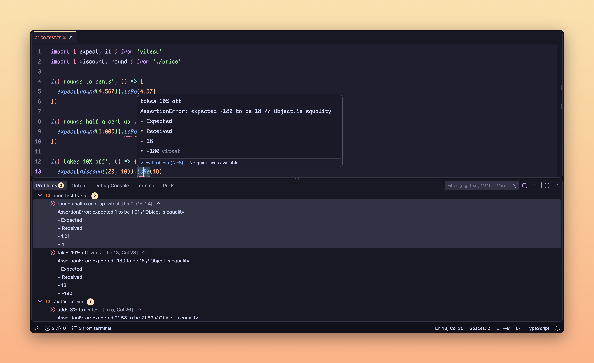

<div align="center">
  
  <h1>Gleaner</h1>
  <p>every error your terminal prints, in the problems panel.</p>


</div>

<br>



run `tsc`, `cargo build` or `pytest` like you always do. gleaner catches the errors as they scroll by and puts them where you can use them: squiggles in your code, a list in the problems panel, one click from the line.

no tasks.json. no problem matchers. nothing to set up.

## why it's nice

- **zero setup.** install it and keep typing the commands you already type.
- **40+ tools.** compilers, type checkers, linters, test runners and crash traces, out of the box.
- **always current.** fix an error and rerun: it's gone. `tsc --watch` and vitest update on every save. every other command keeps its own list.
- **no noise.** a problem only shows up if its file really exists, so random output never turns into fake errors.
- **the whole story.** "declared here", compiler notes and call stacks come along with each problem.
- **yours alone.** runs on your machine. no network, no telemetry, no account.

## works with

| language               | tools                                                                                                  |
| ---------------------- | ------------------------------------------------------------------------------------------------------ |
| typescript, javascript | `tsc`, `vue-tsc`, `tsgo`, `eslint`, `biome`, `esbuild`, `vite`, `jest`, `vitest`, `bun test`, `deno`   |
| js runtimes            | crashes from `node`, `tsx`, `ts-node`, `bun`, `deno`                                                   |
| c, c++, swift, zig     | `gcc`, `g++`, `clang`, `clang++`, `cc`, `swiftc`, `swift build`, `cppcheck`, `zig` (errors and panics) |
| build files            | `make` (its own errors), `cmake`, compiler errors from `cmake --build`                                 |
| rust                   | `cargo build`, `cargo check`, `cargo clippy`, `cargo test`, `rustc`                                    |
| go                     | `go build`, `go vet`, `go test`, `go run` panics                                                       |
| python                 | tracebacks, `pytest`, `pyright`, `mypy`, `ruff`, `flake8`, `pylint`                                    |
| java                   | `javac`, uncaught exceptions from `java`                                                               |
| c#                     | `dotnet build`, `msbuild`                                                                              |
| ruby, lua              | crashes and syntax errors from `ruby`, `ruby -c`, `lua`, `luajit`                                      |
| shell                  | `shellcheck`                                                                                           |

`npx tsc`, `uv run pytest`, `cd app && cargo build` and package scripts like `npm run build` all work too. gleaner reads your package.json to see what a script really runs.

## install

get it from the [vs code marketplace](https://marketplace.visualstudio.com/items?itemName=thesecondcoming123.gleaner), or from the command line:

```bash
code --install-extension thesecondcoming123.gleaner
```

## use it

open a terminal in vs code and run your build, linter or tests. that's it.

- the status bar counts what gleaner found. click it to open the problems panel.
- rerun a command to refresh its problems. if you stop a run with ctrl+c, the last list stays.
- **gleaner: clear problems** in the command palette clears everything.

| setting                   | default                               | what it does                                                   |
| ------------------------- | ------------------------------------- | -------------------------------------------------------------- |
| `gleaner.enable`          | `true`                                | turn gleaner on or off                                         |
| `gleaner.ignoredCommands` | `ls`, `cat`, `grep`, `rg`, `git`, ... | commands to never read, for output that only looks like errors |

## faq

**which shells work?**
anything with vs code's shell integration: zsh, bash, fish and powershell on macos, linux and windows, plus git bash, remote ssh and wsl. `cmd`, `tmux` and a plain `ssh` you typed yourself don't report their commands, so gleaner can't see them.

**does it work with watch mode?**
yes, for `tsc --watch` and vitest (which watches by default). each pass updates the list as you save, and stopping the watcher keeps the last one. other watchers report when you stop them.

**it missed an error.**
open an issue with the command and its raw output. every parser is tested against real output from the real tool, so your sample becomes a test.

**i already use tasks.json.**
keep it. gleaner covers everything you type outside of tasks.

## build

```bash
pnpm install
pnpm test        # every parser against real tool output
pnpm lint
pnpm typecheck
pnpm e2e         # drives a real vs code window
```

## license

[MIT](LICENSE). made by [alan bagel](https://alanthebagel.com) ([github](https://github.com/TheSecondComing123)).
